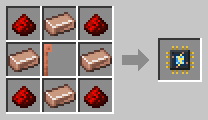

# ArcBot

[Home](README.md) · [Robots](Robots.md)

The ArcBot hunts the hostile mobs in its area from a distance, with arcs of electricity. It's the dark grey robot with yellow stripes, a bright blue bulb on its head and a lightning rod in each hand: its plus and minus poles.

## How it works
- It goes after the nearest hostile mob in its area. Once the mob is within **10 blocks** and it can see it, it stops, holds its two rods out, charges up for half a second with sparks crackling between them, and fires.
- The arc **jumps on** to up to two more hostile mobs within 4 blocks of the one it hit, for half the damage.
- An arc does 6 damage, about every second and a half: a spider takes three, a blaze four.
- It does not shoot through walls, and it never hits animals, villagers, players or other robots.
- It hunts in the air above its area too, up to 10 blocks: **spiders** on walls, **blazes**, **ghasts** and **phantoms**. **Creepers** never get close enough to explode.
- It is not a real lightning bolt: nothing catches fire, and creepers do not get charged. The ArcBot itself does not burn either, so a blaze's fireballs cannot hurt it.
- The drops stay on the ground, like the [Killerbot](Killerbot.md)'s. Its kills count as a player's, so mobs drop everything, also what only a player's kill gives, such as a blaze's rods, and their experience.

## Energy
Every arc costs **300 FE**, so a full battery is about 30 arcs, and walking costs twice as much as for most robots. Give it a [Battery Module](Battery-Modules.md), and keep its [charging station](Charging-Station.md) close.

## Recipe
Build it at the [Robot Workshop](Robot-Workshop.md) from a Robot Frame and an **ArcBot Neural Chip**.

## Setup
With the [Robot Linker](Robot-Linker.md), click:
1. two corners on the ground for its area;
2. its charging station.

## Tips
- A [Combat Upgrade](Upgrades.md) makes its arcs reach 14 blocks instead of 10 and do 10 damage instead of 6.
- Every arc counts, also when several ArcBots hit the same mob at once: a mob is not spared for half a second after a hit, as it is from swords. So more ArcBots kill faster, a boss too.
- An [Efficiency Upgrade](Upgrades.md) makes every arc cost a quarter less.
- A [Filter](Filter-Chips.md) picks which mobs it hunts: click **Mobs…** in the filter's screen and pick them from the list.
- Bosses are left alone: the Wither and the Ender Dragon, and the mobs in the `farmerfranks_robotics:ignored_mobs` tag (see [Modpack Makers](Modpack-Makers.md)). To hunt them, pick them in a Whitelist Filter, or tick **Also bosses** in a Blacklist Filter's mob list (see [Filters](Filter-Chips.md)).
- Together with a [Killerbot](Killerbot.md): the Killerbot handles the crowds on the ground, the ArcBot the mobs it cannot reach.
- With a [Collector](Collector.md) in the same area, the drops end up in a chest.
