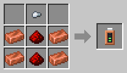
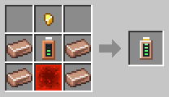

# Battery Modules

[Home](README.md)

A robot holds **10 000 FE** on its own. Put a battery module into it, in the battery slot of the [Robot Workshop](Robot-Workshop.md), to give it more. A bigger battery means fewer trips to the charging station. A robot still goes to charge at 10 %.

| Module | Holds | Charging speed | Recipe |
|---|---|---|---|
|  **Copper Battery Module** | 25 000 FE | normal |  |
|  **Coppersteel Battery Module** | 50 000 FE | twice as fast |  |

A robot has one battery module at most. Taking a module out loses whatever energy does not fit in the robot's own battery.
