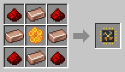

# Beekeeper

[Home](README.md) · [Robots](Robots.md)

The Beekeeper goes round the beehives and bee nests in its area, and when one is full of honey it takes the honeycomb with its shears and brings it to its delivery chest. It's the honey-yellow robot in a white beekeeper's suit, with an amber bulb.

## How it works
- It walks up to the nearest **full** hive (honey level 5), pumps its **smoker** at it for a few seconds to calm the bees, with smoke streaming from the spout over the hive, cuts the comb out with a few snips, and the honeycomb goes straight into its basket: 3 from each hive, as with shears. Hives that are not full yet are left alone.
- **The bees stay calm.** It calms them as it works, so they never get angry, with or without a campfire under the hive.
- It finds hives on the ground and up to **8 blocks above** the ground of its area, such as bee nests in the trees, and reaches up to 6 blocks. It walks to the ground under a hive it cannot get next to.
- It brings the honeycomb to its chest when its basket is full (4 stacks), now and then, or when there is no full hive left.

## Honey Upgrade
With a [Honey Upgrade](Upgrades.md) it taps the honey instead of cutting out the comb: **250 mB** of liquid honey a hive, as much as a bottle holds, and it takes it to a **tank**, such as a [Glass Tank](Glass-Tank.md). Link the tank instead of a chest with the Robot Linker. It carries 4 000 mB, 8 000 mB with a Capacity Upgrade. The honey is in the `c:honey` tag, so tanks, pipes and machines from other mods take it too.

## Recipe
Build it at the [Robot Workshop](Robot-Workshop.md) from a Robot Frame and a **Beekeeper Neural Chip**. The chip takes a honeycomb, so shear your first hive yourself.

## Setup
With the [Robot Linker](Robot-Linker.md), click:
1. two corners on the ground for its area;
2. the chest to deliver to (Shift + click more than one, see [more than one chest](Robot-Linker.md#more-than-one-chest-or-machine));
3. its charging station.

## Getting bees near your base
- **Move a bee nest** with a Silk Touch tool, best at night or in the rain, when all the bees are in. The bees and the honey come with it. Bee nests grow on birch and oak trees in plains, meadows, sunflower plains and flower forests.
- **Make a beehive** from 6 planks and 3 honeycomb, and get bees to move in.
- **Lead bees home:** they follow you while you hold a flower, and you can put them on a lead. Breed more with flowers; they move into a free hive by themselves.
- **Grow a bee nest:** an oak or birch grown from a sapling with flowers within 2 blocks gets a nest with bees about 5 % of the time.

## Tips
- A [Capacity Upgrade](Upgrades.md) doubles its basket to 8 stacks.
- Flowers near the hives fill them faster, and the bees pollinate crops they fly over, so a Beekeeper goes well next to a [Planter](Planter.md) and [Harvester](Harvester.md).
