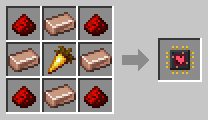

# Breeder

[Home](README.md) · [Robots](Robots.md)

The Breeder feeds the grown-up animals in its area so they breed, with whatever each animal eats: wheat for cows and sheep, carrots for pigs, seeds for chickens and so on, fetched from its feed chest. It's the lavender robot in green dungarees.

## How it decides who to feed
- It only feeds an animal that has a partner of its kind to breed with, and feeds the second of a pair first.
- It stops at **16 animals of a kind** in its area, so the pen does not overfill. Servers can change this in the [config](Configuration.md).
- It reaches 3 blocks, so it can feed animals over the fence of a pen.
- Food that no animal wants right now goes back in the chest.

## Recipe
Build it at the [Robot Workshop](Robot-Workshop.md) from a Robot Frame and a **Breeder Neural Chip**.

## Setup
With the [Robot Linker](Robot-Linker.md), click:
1. two corners on the ground for its area;
2. the chest with animal food;
3. its charging station.

## Tips
- A [Filter](Filter-Chips.md) can hold food (for example a whitelist with carrots: it only feeds carrots, to the animals that eat them), or spawn eggs (which animals to breed).
- Pair it with a [Butcher](Butcher.md) to keep the numbers down.
- Uses the normal amount of energy (1×).
