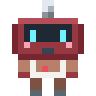
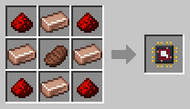

# Butcher

[Home](README.md) · [Robots](Robots.md)

The Butcher counts the grown-up animals of each kind in its area, and butchers the ones beyond the number it keeps. The drops go to its delivery chest. It wears a white apron and carries a cleaver.

## Which animals are safe
- It keeps **8 of each kind** to start with. Change it in its [Robot Panel](Robot-Linker.md#the-robot-panel) (Ctrl + right-click it) with the − and + buttons, from 1 to 128 (Shift + click for 5 at a time), or Shift + right-click it with the [Inspector](Inspector.md) to choose 2, 4, 6, 8, 12 or 16.
- Young animals, animals with a **name tag** and animals in love are never touched.

## Recipe
Build it at the [Robot Workshop](Robot-Workshop.md) from a Robot Frame and a **Butcher Neural Chip**.

## Setup
With the [Robot Linker](Robot-Linker.md), click:
1. two corners on the ground for its area;
2. the chest to deliver to;
3. its charging station.

## Tips
- With a [Breeder](Breeder.md) in the same pen, the farm runs by itself.
- A [Filter](Filter-Chips.md) with spawn eggs picks which animals it butchers.
- Uses twice the normal amount of energy (2×).
