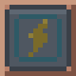
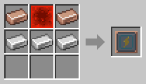

# Charging Station

[Home](README.md)

A low pad that robots stand on to charge. **Every robot needs its own Charging Station**, set with the [Robot Linker](Robot-Linker.md).

When a robot's battery drops to 10 %, it walks back to its station, stands on it until it is full, and then goes back to work. The pad lights up while a robot charges.

**How full it is:** the four lamps along each side of the pad show how much energy the station has: green from three quarters full, yellow from half, orange from a quarter, red below that, and dark when it is empty.

**A station close by:** if another Charging Station with energy is within 16 blocks and closer than its own, the robot charges there instead, for example a Power Porter at the far end of its trip. Only one robot stands on a pad at a time. Servers can change the distance in the [config](Configuration.md).

## Powering it
The station holds 20 000 FE, or more with battery modules (see below), and takes up to 500 FE/t. It takes energy in from any side:
- a [Battery or a generator](Energy.md) right next to it;
- a pipe or cable from another mod.

Each side that has something attached gets a connector at the edge of the pad: a socket standing up for a pipe or cable, or a low dock along a whole block such as a battery.

Right-click the station to see how much energy it has.

## The Charging Station panel
**Ctrl + right-click** the station to open its panel. A plain right-click still shows how much energy it has.
- **Name:** give the station a name, such as "Barn" or "Mine". The [Robot Panel](Robot-Linker.md#the-robot-panel) and the [Robot Monitor](Robot-Monitor.md) then show it for the robots that charge here, instead of just where it is. The name stays when you pick the station up, and a name given at an anvil works too.
- **Battery modules:** four slots, each adding what its module holds: 25 000 FE for a Copper Battery Module, 50 000 FE for a Coppersteel one. With four Coppersteel ones the station holds **220 000 FE**. A module only comes out while the energy still fits without it, and the modules stay in the station when you pick it up.
- **Robots charging here:** the robots that have this station as theirs, with their names, as long as they are loaded.

## Tips
- A [Coppersteel Battery Module](Battery-Modules.md) makes a robot charge twice as fast.
- Several stations can share one battery, as long as each touches it or is piped to it.
