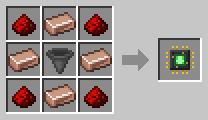

# Collector

[Home](README.md) · [Robots](Robots.md)

The Collector picks up items lying on the ground in its area and delivers them to a chest. It's the green robot.

## Recipe
Build it at the [Robot Workshop](Robot-Workshop.md) from a Robot Frame and a **Collector Neural Chip**.

## Setup
With the [Robot Linker](Robot-Linker.md), click:
1. two corners on the ground for its area;
2. the chest to deliver to;
3. its charging station.

## Tips
- It goes well with a [Lumberjack](Lumberjack.md) or a [Killerbot](Killerbot.md), which leave their drops on the ground.
- A [Magnet Upgrade](Upgrades.md) lets it pick up items from 3 blocks away, even over a fence or wall.
- A [Capacity Upgrade](Upgrades.md) lets it carry two stacks.
- A [Filter](Filter-Chips.md) decides which items it picks up.

## Experience
With an [XP Upgrade](Upgrades.md) it picks up **experience orbs** in its area too, for example from a [Killerbot](Killerbot.md) or [ArcBot](ArcBot.md). It carries up to 500 points (about level 21) and pours them as **Liquid Experience** into a tank: Ctrl + right-click it to open its Robot Panel, and click **Set** next to **XP tank**. Any block that holds fluids works, also tanks from other mods. Liquid Experience is in the `c:experience` tag, 20 mB for each point of experience.

To get the experience: **Shift + right-click** a [Glass Tank](Glass-Tank.md) of Liquid Experience with an empty hand. If the tank is full, the Collector keeps what it has and tries again a little later. Without a tank set, it leaves the orbs alone.

- Uses the normal amount of energy (1×).
