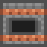
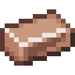
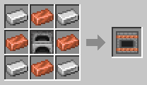
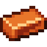
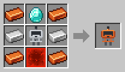
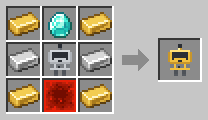
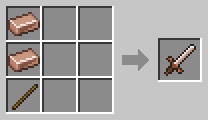

# Coppersteel and the Robotics Foundry

[Home](README.md)

 

**Coppersteel Ingots** are the base of almost everything in the mod. They are made in the **Robotics Foundry**. (Before 0.23.0 it was called the Alloy Furnace.)

## Robotics Foundry

Put **iron** in one input slot and **copper** in the other, and furnace fuel below. Ores, raw metal and ingots all work. After 10 seconds you get one Coppersteel Ingot and a little experience.

The furnace burns the same fuels as a normal furnace. Use the **Sides** button in its screen to choose what each side does, for example input from a hopper on top and output into a hopper below.

## Embersteel and Sunsteel
 

Two stronger alloys, made in the Robotics Foundry from a **Coppersteel Ingot** and one more thing. Each takes 15 seconds:
- **Embersteel:** a Coppersteel Ingot and a **blaze rod**. Glowing red and orange.
- **Sunsteel:** a Coppersteel Ingot and a **gold ingot**. Gold.

They are in the `c:ingots/embersteel` and `c:ingots/sunsteel` tags.

## Advanced Robot Frames
The frames of the Advanced Robots, made from a Robot Frame, four ingots of the new alloy, a diamond, two iron ingots and a block of redstone.
- **Advanced Battle Frame** (Embersteel): builds an [Advanced Killerbot](Killerbot.md#advanced-killerbot) or [Advanced ArcBot](ArcBot.md#advanced-arcbot) at the Robot Workshop.
- **Advanced Worker Frame** (Sunsteel): for all the other robots. Not in use yet.

 

## Coppersteel Sword
A sword made from Coppersteel. It sets mobs on fire when it hits them.

## Note for modpacks
Coppersteel Ingots are in the `c:ingots/coppersteel` tag, and every recipe that uses them asks for the tag. The Robotics Foundry recipe itself cannot be changed with a datapack yet. See [Modpack Makers](Modpack-Makers.md).
