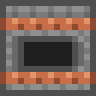
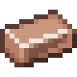
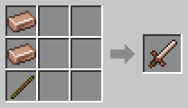

# Coppersteel and the Alloy Furnace

[Home](README.md)

 

**Coppersteel Ingots** are the base of almost everything in the mod. They are made in the **Alloy Furnace**.

## Alloy Furnace

Put **iron** in one input slot and **copper** in the other, and furnace fuel below. Ores, raw metal and ingots all work. After 10 seconds you get one Coppersteel Ingot and a little experience.

The furnace burns the same fuels as a normal furnace. Use the **Sides** button in its screen to choose what each side does, for example input from a hopper on top and output into a hopper below.

## Coppersteel Sword
A sword made from Coppersteel. It sets mobs on fire when it hits them.

## Note for modpacks
Coppersteel Ingots are in the `c:ingots/coppersteel` tag, and every recipe that uses them asks for the tag. The Alloy Furnace recipe itself cannot be changed with a datapack yet. See [Modpack Makers](Modpack-Makers.md).
