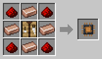

# Crafter

[Home](README.md) · [Robots](Robots.md)

The Crafter works for an [Order Terminal](Order-Terminal.md) at a crafting table, with a hammer in one hand. It knows **twelve recipes**, and crafts what is ordered in the terminal's **Recipes** tab. The [Storage Managers](Storage-Manager.md) bring it the ingredients, and it takes what it makes to the terminal's output.

## Recipe
Build it at the [Robot Workshop](Robot-Workshop.md) from a Robot Frame and a **Crafter Neural Chip**.

## Setup
With the [Robot Linker](Robot-Linker.md), click:
1. the Order Terminal it works for;
2. the crafting table it works at;
3. its charging station.

The terminal needs at least one [Storage Manager](Storage-Manager.md) too, to bring the ingredients.

## Recipes
Open its Robot Panel: its twelve recipes are at the bottom. Click **Edit**, pick one of the twelve, and lay the items out in the grid as in a crafting table. It shows what they make. **Clear** empties a recipe.

With **JEI**, press **+** on a crafting recipe to lay it out in the grid. Where any of several items will do, such as any planks, it picks one you have.

## Ordering
The terminal's **Recipes** tab lists everything its Crafters can make. See the [Order Terminal](Order-Terminal.md#recipes-tab) for how ordering works, how parts are made first, and how to keep things in stock.

- It makes a whole order in one go, even of things that do not stack.
- What is left over, such as empty buckets, goes in the terminal's input to be put away.
- It only swings its hammer while it crafts, and waits calmly at its table for its ingredients.

## Tips
- A [Speed Upgrade](Upgrades.md) makes it craft twice as fast.
- Between them, Crafters with different recipes can make long chains, such as logs → planks → sticks → tools.
- Uses the normal amount of energy (1×).
