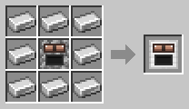
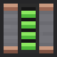

# Energy: Generators and the Battery

[Home](README.md)

Robots and machines run on **FE** (Forge Energy), the standard energy of NeoForge mods. Pipes and cables from other mods, such as Pipez, work with all of the blocks below.

## Generators
 

Generators burn furnace fuel. **One coal gives 10 000 FE in either generator.** Other fuels give energy in proportion to how long they burn in a furnace: a plank gives 1 875 FE, a blaze rod 15 000 FE and a bucket of lava 125 000 FE.

| Generator | Output | Buffer |
|---|---|---|
| Stone Generator | 25 FE/t | 1 000 FE |
| Iron Generator | 50 FE/t | 2 000 FE |

The Iron Generator makes the same energy from a coal, but twice as fast. A generator only burns fuel while it has room in its buffer, so no fuel is wasted. Empty buckets from lava can be pulled out of output sides.

## Battery

The Battery stores **100 000 FE**, and moves up to 200 FE/t in and out. It takes energy in on every side but the front, which gives it out, and the gauge on the front shows how full it is. It keeps its charge when you break it and pick it up. Comparators read how full it is.

## Sides
The generators, the Battery, the [Alloy Furnace](Coppersteel.md) and the [Robot Workshop](Robot-Workshop.md) all have a **Sides** button in their screen. For each side (front, back, left, right, top, bottom) choose **Input**, **Output**, **Input + Output** or **Disabled**. Output sides push energy into blocks right next to them.

## Moving energy without cables
The [Power Porter](Power-Porter.md) carries 25 000 FE at a time from one battery to another.

Server owners can change the energy per coal and the generator output in the [config](Configuration.md).
