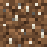
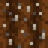
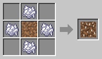

# Fertilized Dirt and Farmland

[Home](README.md)

 

## Fertilized Dirt
Saplings planted on Fertilized Dirt grow **four times as fast**, which is great for a [Lumberjack](Lumberjack.md)'s tree farm. Green sparkles show when a sapling is being helped along. It never runs out.

## Fertilized Farmland
Till Fertilized Dirt with a hoe, or let a [Planter](Planter.md) do it, to get Fertilized Farmland. Crops on it grow **four times as fast** too.

It needs water like normal farmland. When it dries out or is trampled, it turns back into Fertilized Dirt, not plain dirt.
