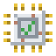
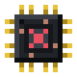
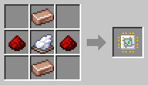
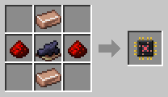

# Filter Chips

[Home](README.md)

 

A Filter Chip decides what a robot works with.
- A **White Filter Chip** is a whitelist: the robot only works with the picked items.
- A **Black Filter Chip** is a blacklist: the robot works with everything but them.

## Using one
1. Right-click with the chip to open it.
2. Shift + click items in your inventory, or click a slot with an item, to add up to 5. Click a slot to remove its item.
3. Put the chip into the robot in the filter slot of the [Robot Workshop](Robot-Workshop.md).

## What the filter means for each robot
| Robot | The filter picks |
|---|---|
| [Transporter](Transporter.md) | which items it carries |
| [Collector](Collector.md) | which items it picks up |
| [Lumberjack](Lumberjack.md) | which saplings it plants |
| [Planter](Planter.md) | which seeds it sows |
| [Harvester](Harvester.md) | which crops it harvests, by what they give (wheat) or their seeds |
| [Fisher](Fisher.md) | which catches it keeps |
| [Killerbot](Killerbot.md) | which mobs it hunts, by spawn egg |
| [Breeder](Breeder.md) | which food it uses, or which animals it breeds, by spawn egg |
| [Butcher](Butcher.md) | which animals it butchers, by spawn egg |
| [Fluid Porter](Fluid-Porter.md) | which fluids it carries, by bucket (a lava bucket for lava) |

## Recipes

