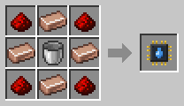

# Fluid Porter

[Home](README.md) · [Robots](Robots.md)

The Fluid Porter carries fluids from one tank to another in two blue canisters, one in each hand. It works with [Glass Tanks](Glass-Tank.md), and with tanks and machines from other mods that hold fluids. It's the teal and white robot.

## How it works
1. It walks to the source tank, sets its canisters down and fills them with **4 buckets** of fluid. Drops run along the hose while it does.
2. It picks them up and carries them over to the target tank.
3. There it sets them down again and empties them.

It carries one fluid at a time. If the source runs dry, it brings what it has. If the target is full, it waits. Its own power comes from its charging station.

## Recipe
Build it at the [Robot Workshop](Robot-Workshop.md) from a Robot Frame and a **Fluid Porter Neural Chip**.

## Setup
With the [Robot Linker](Robot-Linker.md), click:
1. the tank to take fluid from;
2. the tank to bring fluid to;
3. its charging station.

A machine from another mod counts as a tank if it holds fluids, even if it also holds items.

## Tips
- A [Capacity Upgrade](Upgrades.md) doubles its cargo to 8 buckets.
- A [Filter](Filter-Chips.md) with buckets picks which fluids it carries, for example a lava bucket for lava.
- Servers can change the cargo in the [config](Configuration.md).
- Uses the normal amount of energy (1×).
