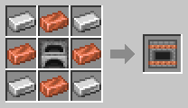
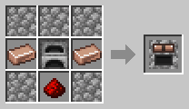
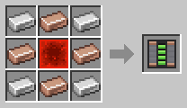
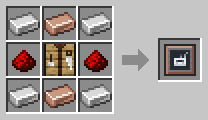
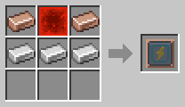
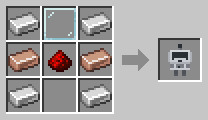
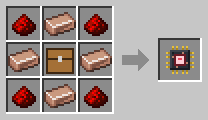

# Getting Started

[Home](README.md)

This page takes you from nothing to your first working robot. Every player also gets a [Robotics Manual](Robotics-Manual.md) the first time they join, with the same information in-game.

## 1. Make Coppersteel
Almost everything in the mod is made from **Coppersteel Ingots**. Craft an [Alloy Furnace](Coppersteel.md), put iron in one input and copper in the other, and add fuel.

## 2. Make energy
Robots and machines run on FE (Forge Energy). Craft a **Stone Generator** and a **Battery**. Put them next to each other, and burn coal in the generator. See [Energy](Energy.md).

## 3. Build a Robot Workshop and a Charging Station
The [Robot Workshop](Robot-Workshop.md) builds robots and needs 4 000 FE per robot. Every robot also needs its own [Charging Station](Charging-Station.md). Put the battery or generator right next to both.

## 4. Build your first robot
Craft a **Robot Frame** and a **Neural Chip**. The chip decides what the robot does. The Transporter Neural Chip is a good first robot. Put the frame and the chip into the Robot Workshop and wait 10 seconds.

## 5. Set it up
Take the robot out of the workshop, and right-click a block to put it down. Craft a [Robot Linker](Robot-Linker.md):
1. Right-click the robot with the linker.
2. Follow the steps shown above the hotbar. A Transporter asks for the chest to fetch from, the chest to deliver to, and its charging station.
3. Right-click the robot again to hand it the setup.

That's it: the robot gets to work, and walks back to its charging station when its battery is low.

## Next steps
- Try the other [robots](Robots.md). A Lumberjack and a Collector together make a tree farm that runs itself, and so do a Planter and a Harvester for crops.
- Give robots [upgrades](Upgrades.md), [battery modules](Battery-Modules.md) and [filters](Filter-Chips.md) at the Robot Workshop.
- Right-click a robot with the [Inspector](Inspector.md) to see everything it is doing.
