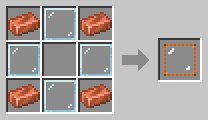

# Glass Tank

[Home](README.md)

A copper-framed glass tank that holds **16 buckets** (16 000 mB) of one fluid. You can see the fluid inside, and it rises and falls as the tank fills and empties. Lava and other fluids that give off light glow inside it.

## Using it
- **Right-click with a bucket** (or another fluid container) to fill or empty it.
- **Right-click with an empty hand** to see what is in it, for example "Water: 8 000 / 16 000 mB".
- **Fluid pipes** from other mods connect on every side.
- A [Fluid Porter](Fluid-Porter.md) can carry fluid to and from it.
- It **keeps its fluid** when you break it and pick it up. The item's tooltip shows what is in it.
- **Comparators** read how full it is.

