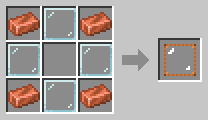

# Glass Tank

[Home](README.md)

A copper-framed glass tank that holds **16 buckets** (16 000 mB) of one fluid. You can see the fluid inside, and it rises and falls as the tank fills and empties. Lava and other fluids that give off light glow inside it.

## Using it
- **Right-click with a bucket** (or another fluid container) to fill or empty it.
- **Right-click a tank of honey with a glass bottle** to fill it with honey (250 mB), and with a honey bottle to pour it in, for example the honey a [Beekeeper](Beekeeper.md) with a Honey Upgrade brings.
- **Look at it** to see what is in it above the hotbar, for example "Water: 8 000 / 16 000 mB".
- **Right-click with an empty hand** to open its panel: what is in it, and how each side is set up, as on a battery. Click a side to choose what pipes, robots and the tanks next to it may do there: put fluid in, take it out, both (green), or neither. A tank looks the same all round, so the sides are shown as you see them: the front is the side towards you, and left and right are your left and right.
- **Shift + right-click with an empty hand** a tank of Liquid Experience to take all the experience in it. A [Collector](Collector.md) with an XP Upgrade fills it.
- **Fluid pipes** from other mods connect on the sides that are open in its panel; to start with, every side.
- A [Fluid Porter](Fluid-Porter.md) can carry fluid to and from it.
- It **keeps its fluid** when you break it and pick it up. The item's tooltip shows what is in it.
- **Comparators** read how full it is.
- **Tanks next to each other work as one big tank**, as long as the sides between them let fluid both in and out, as they do to start with. Fluid runs down into a tank below and levels out with the tanks beside it, so put more tanks side by side, or on top of each other, for more room. Filling one fills them all, and a pipe or a robot can empty them all from one. Tanks only share with tanks that are empty or hold the same fluid, so lava and water never mix.
- **A side set to only put fluid out** passes all of it on: into a tank set to take it on that side, or a bucket at a time into anything else that takes fluid, such as a [Mixing Vat](Mixing-Vat.md) or a pipe. A side set to neither keeps the tank to itself.

The [Mixing Vat](Mixing-Vat.md) has a tank of its own, for the milk, honey or lava it mixes.

