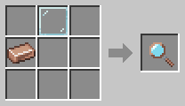

# Inspector

[Home](README.md)

Right-click a robot with the Inspector to see everything about it in chat:
- what it is doing;
- its battery and health;
- its modules, filter, and what it carries;
- what it still needs, if it is not fully set up.

Its **area, chests and charging station are outlined** in the world for 5 seconds, with a dotted line from the robot to each of them, so you can see where it works.

**Shift + right-click a [Butcher](Butcher.md)** to change how many animals of each kind it keeps: 2, 4, 6, 8, 12 or 16.

