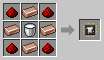

# Milker

[Home](README.md) · [Robots](Robots.md)

The Milker milks the cows and goats in its area and takes the milk to a tank. It's the white robot in black overalls, like a cow, with a pink bulb and a bucket in its hand.

## How it works
- It walks up to the nearest grown-up **cow** or **goat**, milks it for a moment, and keeps the bucket of milk (1 000 mB).
- Each animal then **rests for 5 minutes** before it is milked again, so ten cows give about two buckets a minute.
- **Calves, kids and mooshrooms** are left alone.
- It takes the milk to its tank when it carries 8 buckets (16 with a [Capacity Upgrade](Upgrades.md)), now and then, or when there is no animal left to milk.

## The milk
The milk is NeoForge's own milk fluid, in the `c:milk` tag, so tanks, pipes and machines from other mods take it. A [Glass Tank](Glass-Tank.md) holds 16 buckets of it, and milk buckets pour into it and fill from it too. A [Fluid Porter](Fluid-Porter.md) can carry it on.

## Recipe
Build it at the [Robot Workshop](Robot-Workshop.md) from a Robot Frame and a **Milker Neural Chip**.

## Setup
With the [Robot Linker](Robot-Linker.md), click:
1. two corners on the ground for its area;
2. the tank to take the milk to (Shift + click more than one, see [more than one chest](Robot-Linker.md#more-than-one-chest-or-machine));
3. its charging station.

## Tips
- With a [Breeder](Breeder.md) in the same pen, there are always more cows; a [Butcher](Butcher.md) keeps the numbers down.
