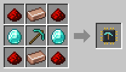

# Miner

[Home](README.md) · [Robots](Robots.md)

The Miner digs out its area one layer at a time, from the ground all the way down to bedrock, and brings what it finds to its chest. It's the stone-grey robot in a hi-vis vest, with a diamond pickaxe and a bright headlamp.

## How it works
1. It keeps the corner nearest the start of its area for its ladder. It digs that corner first on every layer, puts a Miner's Ladder in it, and climbs down.
2. Then it digs out the rest of the layer, row by row, and goes on to the layer below. Standing over the part it has dug out, it is held up by a beam of energy down to the floor below.
3. When its basket is full (8 stacks, 16 with a [Capacity Upgrade](Upgrades.md)) or its battery runs low, it climbs up, empties the basket into the chest, charges, and climbs back down.
4. When it reaches bedrock, it climbs up for the last time and stays by its chest.

Ores drop as if mined with a diamond pickaxe. It leaves chests, spawners and other blocks that hold something alone.

## Ladders
The Miner makes its own **Miner's Ladder** as it goes, one per layer, so it needs nothing from you. You can climb down it yourself to the bottom of the shaft. It has no item, though: break it and it shatters like glass, leaving nothing behind, so a Miner is no free source of ladders.

With a **[Jetpack Upgrade](Upgrades.md)** it flies up and down instead, with flames under its feet, and gets up and down much faster.

With a **[Luck Upgrade](Upgrades.md)** it digs as with a Fortune III pickaxe: more diamonds, coal, redstone, lapis and other ores.

## Water, lava and caves
- **Water and lava** next to the shaft are walled off with cobblestone before it digs beside them, so nothing runs in. Water and lava inside its area are cleared away.
- **Caves** are no problem: it only digs the solid blocks in each layer, and never falls.
- Nothing down there can hurt it: lava, fire, falling and drowning do no harm to a Miner.

## Recipe
Build it at the [Robot Workshop](Robot-Workshop.md) from a Robot Frame and a **Miner Neural Chip**: a diamond pickaxe and two diamonds.

## Setup
With the [Robot Linker](Robot-Linker.md), click:
1. two corners on the ground for its area, up to **16 × 16** blocks (32 × 32 with a [Range Upgrade](Upgrades.md));
2. its chest;
3. its charging station.

Put the chest and the charging station on the ground next to the area, not inside it.

The area can also start **below the ground**: click the corners lower down, for example inside an old pit. The Miner then digs its ladder down from the ground at the corner to the top of the area, digs out the area from there, and climbs all the way back up to empty its basket. The ground above the area is left alone.

If it cannot find a way to the ladder corner (the corner with the lowest X and Z), its status shows **Can't get to its ladder corner**. Open a way, or put it down closer to the corner.

## Advanced Miner
Built on an [Advanced Worker Frame](Coppersteel.md#advanced-robot-frames) at the [Robot Workshop](Robot-Workshop.md), it becomes an **Advanced Miner** with room for **three different upgrades**. Good ones for it: a **Drill Upgrade** (each block in half the time), a **Jetpack** (flies, no ladders), **Luck** (Fortune III), **Capacity** (a bigger basket) and **Range** (a bigger area). It has a thin Sunsteel band round its head and a gold ball on its antenna.

## Tips
- Its battery holds **four times as much** as other robots', so it does not have to climb up to charge often.
- A **Blacklist Filter** with stone, cobblestone, deepslate and dirt keeps the chest from filling up with them. What the filter does not let through is thrown away.
- Uses twice the normal amount of energy (2×), plus a little for every block it digs.
- Servers can change the biggest area in the [config](Configuration.md).
