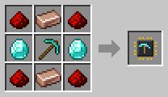

# Miner

[Home](README.md) · [Robots](Robots.md)

The Miner digs out its area one layer at a time, from the ground all the way down to bedrock, and brings what it finds to its chest. It's the stone-grey robot in a hi-vis vest, with a diamond pickaxe and a bright headlamp.

## How it works
1. It keeps the corner nearest the start of its area for a ladder. It digs that corner first on every layer, puts a ladder in it, and climbs down.
2. Then it digs out the rest of the layer, row by row, and goes on to the layer below.
3. When its basket is full (8 stacks, 16 with a [Capacity Upgrade](Upgrades.md)) or its battery runs low, it climbs up, empties the basket into the chest, charges, and climbs back down.
4. When it reaches bedrock, it climbs up for the last time and stays by its chest.

Ores drop as if mined with a diamond pickaxe. It leaves chests, spawners and other blocks that hold something alone.

## Ladders
Put **ladders in its chest**. It takes up to 64 at a time and places one per layer. Without ladders it cannot dig deeper: it waits by the chest, and the [Inspector](Inspector.md) says it needs ladders.

With a **[Jetpack Upgrade](Upgrades.md)** it flies up and down instead, with flames under its feet, and needs no ladders. It also gets up and down much faster.

## Water, lava and caves
- **Water and lava** next to the shaft are walled off with cobblestone before it digs beside them, so nothing runs in. Water and lava inside its area are cleared away.
- **Caves** are no problem: it only digs the solid blocks in each layer, and never falls.
- Nothing down there can hurt it: lava, fire, falling and drowning do no harm to a Miner.

## Recipe
Build it at the [Robot Workshop](Robot-Workshop.md) from a Robot Frame and a **Miner Neural Chip**: a diamond pickaxe and two diamonds.

## Setup
With the [Robot Linker](Robot-Linker.md), click:
1. two corners on the ground for its area, up to **16 × 16** blocks (32 × 32 with a [Range Upgrade](Upgrades.md));
2. its chest, which is where the ladders go too;
3. its charging station.

Put the chest and the charging station on the ground next to the area, not inside it.

## Tips
- Its battery holds **four times as much** as other robots', so it does not have to climb up to charge often.
- A **Black Filter Chip** with stone, cobblestone, deepslate and dirt keeps the chest from filling up with them. What the filter does not let through is thrown away.
- Uses twice the normal amount of energy (2×), plus a little for every block it digs.
- Servers can change the biggest area in the [config](Configuration.md).
