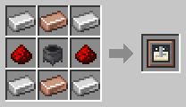

# Mixing Vat

[Home](README.md)


A machine with a tank inside that mixes a fluid with items into something new, using energy. It is where the milk from a [Milker](Milker.md) and the honey and honeycomb from a [Beekeeper](Beekeeper.md) become useful.

## Recipes
| Fluid | Item | Makes | Time |
|---|---|---|---|
| 250 mB milk | Honeycomb | Slime Ball | 5 s |
| 1 000 mB honey | – | Honey Block | 3 s |
| 250 mB lava | Slime Ball | Magma Cream | 5 s |

Slime from milk and honeycomb means slime balls without slime chunks or swamps, and Magma Cream without Blazes. Hover the arrow in the vat to see every recipe, and JEI shows them under **Mixing**.

## Using it
- **Energy** goes in on every side, from a [generator, a battery](Energy.md) or energy pipes from other mods. A mix takes 2 000 FE (1 000 FE for a Honey Block), and it holds 20 000 FE.
- **The tank** holds 8 buckets of one fluid. Right-click with a bucket to fill or empty it, or with a honey bottle to pour in honey. Fluid pipes from other mods connect on every side, and a [Fluid Porter](Fluid-Porter.md), a [Milker](Milker.md) or a [Beekeeper](Beekeeper.md) with a Honey Upgrade can be linked to it to fill it.
- **Items** go in the two input slots, one kind in each, and what it makes comes out on the right. Right-click it with anything but a bucket to open it.
- Like the other machines, the **side panel** sets what each side does. Items go in at the top and sides and come out at the bottom to start with, so hoppers and robots can fill and empty it. A Beekeeper can take its honeycomb straight to it.
- It works when it has the fluid, the item and somewhere to put the result. The front lights up and bubbles rise from the top while it mixes.

## Recipe


## For modpacks
The recipes are data, of the type `farmerfranks_robotics:mixing`, so a datapack can add, change or remove them:

```json
{
  "type": "farmerfranks_robotics:mixing",
  "fluid": { "ingredient": "#c:milk", "amount": 250 },
  "ingredients": [ "minecraft:honeycomb" ],
  "result": { "id": "minecraft:slime_ball" },
  "time": 100,
  "energy": 2000
}
```

A recipe takes up to two items (`ingredients`), or none. `time` is in ticks and `energy` is the FE for the whole mix.
