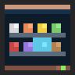
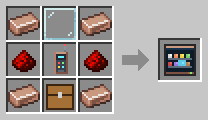

# Order Terminal

[Home](README.md)

The Order Terminal turns a room of chests into **one store**. Its panel shows everything in its chests at once, and you order what you want with a click. [Storage Manager](Storage-Manager.md) robots fetch it to the terminal and put away what you bring back. Add [Crafters](Crafter.md), and the terminal can also have things **crafted**, even things made from other things that have to be made first.

## Setting it up
1. Place the terminal and give it energy: a [generator or battery](Energy.md) right next to it, a pipe, or a [Power Porter](Power-Porter.md). It uses **2 FE/t, and 1 FE/t more for each chest**.
2. Right-click it to open its panel. Open the **⚙** tab on the right side to see the **Setup** panel, and click **+ Add**. The panel closes: right-click each chest, barrel or other storage you want in the store, and then the terminal when you are done.
3. Build a [Storage Manager](Storage-Manager.md) and link it with the [Robot Linker](Robot-Linker.md): the terminal, then its charging station.

A terminal holds up to **16 chests**, within **32 blocks** of it. A double chest counts as one. Chests, barrels, shulker boxes and storage from other mods all work.

## Ordering
The **Store** tab shows everything in the chests, with how many there are. Type in **Search** to find something.

- **Click** an item to order one, **Shift + click** for a stack, and **right-click** for half a stack.
- A Storage Manager fetches it from its chest and puts it in the **Output**. Orders on their way are shown under **On its way**. Click one to cancel it.
- Put things you want stored in the **Input**. The Storage Managers carry them out to the chests, to one that already has the same kind if they can. Something you ordered by mistake can go straight back in the input.

## The Setup panel
The **⚙** tab shows the chests in the store and the robots that work for the terminal, each in a list you can scroll.

- **Chests:** each with a bar showing how full it is. Click **×** to take a chest out of the store.
- **Give a chest a name:** click it in the list, type a name, and press Enter (Esc cancels). The name goes on the chest itself, as if you had named it at an anvil, so it shows when you open the chest, in the [Robot Panel](Robot-Linker.md#the-robot-panel) of other robots that use it, and it stays when you pick the chest up. A double chest gets the name on both halves. Save an empty name to take it away. In the list a named chest shows its name, and holding the mouse over it shows where it is.
- **Robots:** the Storage Managers and Crafters working for the terminal, with what each is doing.

## Recipes tab
With one or more [Crafters](Crafter.md) working for the terminal, the **Recipes** tab lists everything they can make. Click to have it made, with the same clicks as in the store: one, a stack with Shift, half a stack with a right-click. What is made comes to the output.

- **Made first:** if the store does not have an ingredient but a Crafter can make it, it is made first. Order a wooden pickaxe with only logs in the store, and the Crafters make the planks and sticks first, then the pickaxe. The parts go to the store, not the output.
- **Held for the order:** what an order needs is held for it in the store, so other orders do not take it.
- **Something missing:** if something is missing that no Crafter can make, the terminal tells you what before the order goes in. Click **Order anyway**, and it waits until what is missing comes into the store.
- Hold the mouse over an order on its way to see what is still to be made first for it.

### Keep in stock
**Ctrl + click** a recipe and say how many to keep. When the store has fewer, the terminal orders the rest from the Crafters by itself, and what they make goes to the store. It counts what is already on its way and what Storage Managers are carrying to the chests, so it does not make too many. It only orders what the store has the ingredients for, and tries again a little later. What the terminal keeps in stock has a **green corner**. Ctrl + click it again to change the number or remove it.

## Crafting tab
The **Crafting** tab, with the crafting table icon, has a crafting grid of its own.

- Press **+** on a recipe in **JEI**, and it is laid out in the grid. What you have in your inventory goes in at once, and the Storage Managers bring the rest from the store.
- Or put items in yourself, as in a crafting table.
- Take what it makes as from a crafting table, or **Shift + click** to make all the grid has room for.
- **Fill again** fetches enough for one more, and with Shift enough for a stack. A red frame means the store does not have enough.
- The button by the grid empties it, and what was in it goes back to you.

## Tips
- More Storage Managers fetch faster. With a [Capacity Upgrade](Upgrades.md), each carries two stacks at once, from two chests in one trip.
- The robots reach the top of three chests stacked, from the floor beside them. Leave them room to stand in front of the chests.
- Without energy, the terminal says so and nothing is fetched.
