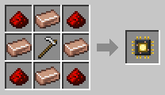

# Planter

[Home](README.md) · [Robots](Robots.md)

The Planter tills dirt and grass in its area into farmland, hacking at the ground with its hoe, and sows the farmland with seeds from its chest: wheat, beetroot, carrots, potatoes and the like. It only tills ground within 4 blocks of water, as in vanilla, so the farmland stays wet. It wears blue overalls.

## Recipe
Build it at the [Robot Workshop](Robot-Workshop.md) from a Robot Frame and a **Planter Neural Chip**.

## Setup
With the [Robot Linker](Robot-Linker.md), click:
1. two corners on the ground for its area;
2. the chest with seeds;
3. its charging station.

## Tips
- Pair it with a [Harvester](Harvester.md), and give the Planter the Harvester's delivery chest as its seed chest. Then the farm runs by itself.
- Tilled [Fertilized Dirt](Fertilized-Dirt.md) becomes Fertilized Farmland, where crops grow four times as fast.
- With a [Watering Can Upgrade](Upgrades.md) it waters a crop every few seconds while it has nothing to till or sow, with its watering can out, pouring for a few seconds. A small field grows about a third faster; a big one hardly faster at all, so Fertilized Farmland is still the way to make crops really fly.
- A [Filter](Filter-Chips.md) decides which seeds it sows.
- **More than one crop in one field:** a Whitelist Filter with two or more kinds of seeds, such as wheat seeds, carrots and potatoes, cuts the area into belts as even as they go, one for each kind in the filter's order, running along the long side of the area. A 9-wide field with three kinds gets three rows of each. Once harvested, each belt is sown with the same kind again, so the field keeps its look. If a kind runs out in the chest, its belt is left empty until more comes, and the Planter says **Pickup chest is empty** while it waits.
- With a **[Capacity Upgrade](Upgrades.md)** and belts, it takes a stack of each kind at once, up to four: one in its hand and the others in its basket. Then it goes from belt to belt without going back to the chest in between.
- Uses the normal amount of energy (1×).
