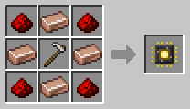

# Planter

[Home](README.md) · [Robots](Robots.md)

The Planter tills dirt and grass in its area into farmland, hacking at the ground with its hoe, and sows the farmland with seeds from its chest: wheat, beetroot, carrots, potatoes and the like. It only tills ground within 4 blocks of water, as in vanilla, so the farmland stays wet. It wears blue overalls.

## Recipe
Build it at the [Robot Workshop](Robot-Workshop.md) from a Robot Frame and a **Planter Neural Chip**.

## Setup
With the [Robot Linker](Robot-Linker.md), click:
1. two corners on the ground for its area;
2. the chest with seeds;
3. its charging station.

## Tips
- Pair it with a [Harvester](Harvester.md), and give the Planter the Harvester's delivery chest as its seed chest. Then the farm runs by itself.
- Tilled [Fertilized Dirt](Fertilized-Dirt.md) becomes Fertilized Farmland, where crops grow four times as fast.
- With a [Watering Can Upgrade](Upgrades.md) it waters a crop every few seconds while it has nothing to till or sow, with a water bucket out. A small field grows about a third faster; a big one hardly faster at all, so Fertilized Farmland is still the way to make crops really fly.
- A [Filter](Filter-Chips.md) decides which seeds it sows.
- Uses the normal amount of energy (1×).
