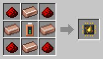

# Power Porter

[Home](README.md) · [Robots](Robots.md)

The Power Porter is a walking battery. It carries energy from one battery to another in two heavy batteries, one in each hand. It is slow, but you need no cables. It's the steel-blue robot with a yellow lightning stripe.

## How it works
1. It walks to the source battery, sets its batteries down and plugs them in, with a stream of sparks between them.
2. Once they are full, with **25 000 FE**, it picks them up and staggers over to the target battery.
3. There it sets them down again and empties them.

If the source runs dry, it brings what it has. If the target is full, it waits. It plugs straight into the battery, whatever the battery's sides are set to. Its own power comes from its charging station, not from the cargo.

## Recipe
Build it at the [Robot Workshop](Robot-Workshop.md) from a Robot Frame and a **Power Porter Neural Chip**.

## Setup
With the [Robot Linker](Robot-Linker.md), click:
1. the battery to take energy from;
2. the battery to bring energy to;
3. its charging station.

## Tips
- A [Capacity Upgrade](Upgrades.md) doubles its cargo to 50 000 FE.
- A [Speed Upgrade](Upgrades.md) helps it carry the heavy batteries faster.
- Servers can change the cargo in the [config](Configuration.md).
- Uses the normal amount of energy (1×).
