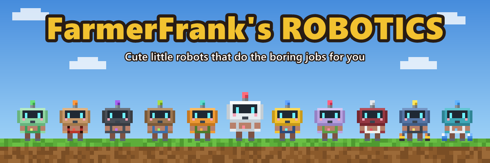
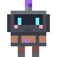

# FarmerFrank's Robotics Wiki

**Cute little robots that do the boring jobs for you.** Build them in a Robot Workshop, give them a Neural Chip that tells them what to do, link them to their chests and charging station, and watch them work.

This wiki is for FarmerFrank's Robotics for **Minecraft 26.3 (NeoForge)**. The mod is in beta, so things may still change.

## Start here
- [Getting Started](Getting-Started.md): from your first Coppersteel Ingot to your first working robot.
- [Robots](Robots.md): all the robots at a glance.
- [Tech tree](https://farmerfrankdev.github.io/farmerfranks-robotics-wiki/techtree/): every part and recipe as a clickable tree, with what each costs.

## Robots
| | | | | |
|---|---|---|---|---|
|  [Transporter](Transporter.md) |  [Collector](Collector.md) |  [Lumberjack](Lumberjack.md) |  [Killerbot](Killerbot.md) |  [Planter](Planter.md) |
|  [Harvester](Harvester.md) |  [Fisher](Fisher.md) |  [Breeder](Breeder.md) |  [Butcher](Butcher.md) |  [Power Porter](Power-Porter.md) |
|  [Fluid Porter](Fluid-Porter.md) |  [Miner](Miner.md) | | | |

## Machines and blocks
- [Coppersteel and the Alloy Furnace](Coppersteel.md)
- [Energy: Generators and the Battery](Energy.md)
- [Charging Station](Charging-Station.md)
- [Robot Workshop](Robot-Workshop.md)
- [Robot Revolving Door](Robot-Revolving-Door.md)
- [Fertilized Dirt and Farmland](Fertilized-Dirt.md)
- [Glass Tank](Glass-Tank.md)

## Tools and modules
- [Robot Linker](Robot-Linker.md)
- [Inspector](Inspector.md)
- [Battery Modules](Battery-Modules.md)
- [Upgrades](Upgrades.md)
- [Filter Chips](Filter-Chips.md)
- [Robotics Manual](Robotics-Manual.md)

## For servers and modpacks
- [Configuration](Configuration.md)
- [Modpack Makers](Modpack-Makers.md)
- [FAQ](FAQ.md)
