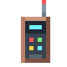
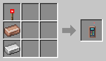

# Robot Linker

[Home](README.md)

The Robot Linker tells a robot where to work: its chests, its charging station and its area.

## Setting up a robot
1. **Right-click the robot** with the linker. This starts a new setup for that kind of robot.
2. **Click what it asks for.** The next step is shown above the hotbar:
   - chests, by clicking them: first the ones it fetches from, then the ones it delivers to;
   - the charging station;
   - an **area**, by clicking the ground at one corner and then at the opposite corner. While you choose the second corner, the area is outlined and its size is shown.
3. **Right-click the robot again** to hand it the setup.

What each robot asks for is listed on [Robots](Robots.md).

## Sides
For a chest the side makes no difference, but a furnace or another mod's machine takes different things on different sides.
- **Delivering:** the robot uses the side you clicked. Click the **top** of a furnace to deliver ore to it, and its **side** to deliver fuel.
- **Fetching:** the robot uses the **bottom**, as a hopper under it would. From a furnace it then only takes what it has made.

## The Robot Panel
**Ctrl + right-click a robot** to open its **Robot Panel**. It shows the robot itself, what it is doing, its battery, what it carries (empty slots too), its modules, and every chest it fetches from and delivers to, with the block and where it is. Each has a button for the side the robot uses: click it to switch between Bottom, Top, Front, Back, Left side, Right side and Any side. Left and right are as you see them standing in front of the block. A block without a front, such as a barrel standing up, counts the side turned towards you as its front. This is handy for machines from other mods that give their output on another side, or for a side you could not click.

The panel also shows the robot's filter, if it has one. Click **Change** to change the items in it, the same way as with a Filter Chip in your hand. Closing the filter takes you back to the Robot Panel.

A robot waits three seconds after you put it down or hand it a setup, so there is time to Ctrl + right-click it before it walks off.

With more than one chest to deliver to, you can also switch between filling one at a time and round robin there.

## More than one chest
A robot can fetch from more than one chest, and deliver to more than one. It works the same for both:
- **Click a chest:** that one chest, and the step is done.
- **More than one:** Shift + click the first chests, and click the last one without Shift. That finishes the step.
- **Shift + click one of them again** to take it away.
- Up to 16 chests to fetch from and 16 to deliver to. Every chest keeps the side you clicked.

This works for the Transporter, Collector, Harvester, Fisher, Butcher, Miner and Wool-E (delivering), and for the Transporter, Lumberjack, Planter and Breeder (fetching). The [Power Porter](Power-Porter.md) and [Fluid Porter](Fluid-Porter.md) do the same with batteries and tanks, both ways.

**Fetching:** the robot takes from the first chest that has something for it, in the order you clicked them.

**Delivering:** right-click the air while setting up the robot to switch how it shares out:
- **Fill one at a time** (the default): it fills one chest, and moves on to the next when it is full.
- **Round robin:** one load to each chest in turn.

When all of them are full, it waits, and tries again from the first one.

## Shortcuts
- **Same setup for more robots:** after handing a setup to one robot, right-click more robots of the same kind to give them the same setup.
- **Copy a setup:** Shift + right-click a robot to copy its setup into the linker.
- **Start over:** Shift + right-click in the air.
- The linker's tooltip shows what is set so far.

## Area size
An area can be up to **32 × 32** blocks, or **48 × 48** for a robot with a [Range Upgrade](Upgrades.md). The linker warns you when an area needs the upgrade. Servers can change both sizes in the [config](Configuration.md).

If you put a robot down without a setup, it tells you to set it up with a linker.
