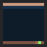
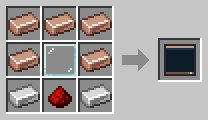

# Robot Monitor

[Home](README.md)

A screen that shows what your robots are doing, **wherever they are**: a [Miner](Miner.md) far away, or a [Killerbot](Killerbot.md) in the Nether. It goes through them one at a time, with a new robot every five seconds.

## Putting a robot on it
1. **Ctrl + right-click the robot** to open its [Robot Panel](Robot-Linker.md#the-robot-panel).
2. Click **Show** next to **Monitor**.

From then on every Robot Monitor you have placed shows it. Click **Remove** in the same place to take it off again. You choose the robots yourself, so the monitor only shows the ones you care about.

## What it shows
- The robot's **name** and what kind of robot it is, and **who owns it**
- What it is **doing** right now
- Its **battery**, and the health of a combat robot
- What it **carries**, or a porter's cargo
- **Where** it is: the world and the coordinates
- Whether it is **live**

## Robots far away
A robot writes what it is doing once a second while its chunk is loaded. In a chunk that is not loaded, the monitor shows the robot as it was when it was last seen, for example "Not loaded – last seen 12 min ago". In mod packs with chunk loaders the robot keeps working, and the monitor shows it live.

A robot that is **destroyed** stays on the monitor, marked in red with where it was last seen, so you know where to find its [Scrap Pile](Force-Shield.md). Take it off when you are done. A robot you **pick up** as an item comes off by itself.

## Using it
- **Right-click it** to open its screen. Go through the robots with the **<** and **>** buttons, and click **Take off** to take one off your monitors.
- It needs **energy**: 2 FE/t, from any side, for example from a generator, a [Battery](Energy.md) or a cable from another mod. Without it the screen is dark.
- Each monitor shows the robots of the player who placed it. In multiplayer, everyone has their own robots on their own monitors.

