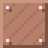
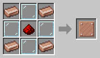

# Robot Revolving Door

[Home](README.md)

A one-block-high revolving door to set into a fence or wall.
- **Robots** walk straight through it, and its glass wings turn as they do.
- **For animals, mobs and players** it is a wall as high as a fence: they cannot get through or jump over it.
- **It lets no light through**, though its middle is see-through.

So robots can work inside an animal pen or a dark mob farm, without anything getting out or any light getting in.

