# Robot Workshop

[Home](README.md)

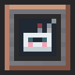 

The Robot Workshop builds robots and changes them. It needs energy: give it a [Battery or generator](Energy.md) right next to it, or a pipe.

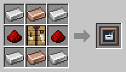

## Building a robot
1. Put a **Robot Frame** in the robot slot, at the feet of the stage in the middle. The frame stands on the stage, dark and with its head hanging: nobody is home yet.
2. Put a **Neural Chip** in the chip slot, at the top on the left. The chip decides what kind of [robot](Robots.md) you get.
3. After **10 seconds** and **12 000 FE**, the frame is a robot. It comes to life with a power-up sound and a little hello, and a bar along the bottom of the stage shows how far it has come.

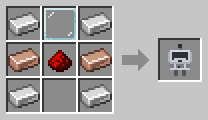

## Modules
The robot turns on the stage in the middle, with its modules round it, each with a line in to it:

| Where | Slot | Module |
|---|---|---|
| Left | Chip | a Neural Chip: what the robot does |
| Left | Frame | the frame the robot is built on, see [below](#moving-a-robot-onto-an-advanced-frame) |
| Left | Battery | a [Battery Module](Battery-Modules.md) |
| Left | Filter | a [Filter](Filter-Chips.md) |
| Right | Upgrade | an [Upgrade](Upgrades.md), three of them on an advanced robot |

Only the slots the robot can use are there: a [Power Porter](Power-Porter.md) has nothing to filter, so it has no filter slot. Hold the mouse over an empty upgrade slot to see **the upgrades that help that robot**, with a tick by the ones it already has, so you know which to make. An upgrade that does nothing for the robot, such as a Magnet Upgrade in a Miner, gets a red frame. With a Robot Frame in the workshop, you can put the other modules in their slots before the chip: they wait there until the chip is in.

- **To put a module in,** put it in its slot. The module the robot had before comes out in the **Out** slot, on the right under the upgrades.
- **To take a module out,** click it. Modules the robot already has are shown in their slots with a green frame and a tick. A module turns red until it is out; click it again to keep it.
- Putting a module in or taking one out takes **5 seconds** and **4 000 FE**. When it is done, the robot slot gets a green frame: take the robot out there.
- **A name of its own,** if you like: type it in the field at the top. It shows in the Robot Panel, the Inspector and above the robot, so you can tell your robots apart. It costs nothing and takes no time. Empty the field to take the name away.
- **The chip comes out last.** It holds the other modules, so it cannot be taken out until they are out. A robot whose chip is taken out powers down and becomes the frame it was built on again: a Robot Frame, or an advanced frame.

## Advanced robots
Put an **Advanced Battle Frame** in the robot slot instead of a Robot Frame, with a Killerbot or ArcBot chip, and the workshop builds an [Advanced Killerbot](Killerbot.md#advanced-killerbot) or [Advanced ArcBot](ArcBot.md#advanced-arcbot). Put an **Advanced Worker Frame** there with any other chip, and it builds an advanced one of that robot, such as an [Advanced Miner](Miner.md#advanced-miner). Each frame only takes its own kind of chip. It then has **three upgrade slots** on the right. A robot has each upgrade only once, so Shift + click puts a second upgrade into a free upgrade slot rather than over the first.

### Moving a robot onto an advanced frame
You don't have to build a robot again to make it advanced. On the left, under the chip, is the **frame slot**, showing the frame the robot is built on. Put an **Advanced Worker Frame** there (or an **Advanced Battle Frame**, for a Killerbot or ArcBot), and after **5 seconds** and **4 000 FE** it is an advanced robot with room for three upgrades. It keeps everything: its charge, links, modules, name and settings. The Robot Frame it was built on comes out in the Out slot.

It works the other way too: a **Robot Frame** in the frame slot makes an advanced robot a plain one again, and its advanced frame comes out. Take its second and third upgrades out first: until then the Robot Frame waits in its slot with a red frame.

The robot stays in its slot the whole time. Use the **Sides** button to let hoppers and pipes put frames and modules in.

## Neural Chips
| Chip | Recipe |
|---|---|
| Transporter | 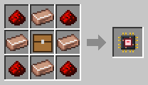 |
| Collector | 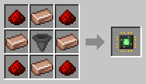 |
| Lumberjack | 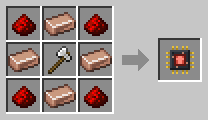 |
| Killer | 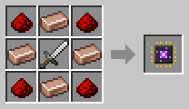 |
| Planter | 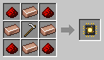 |
| Harvester | 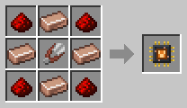 |
| Fisher | 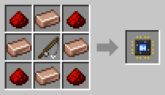 |
| Breeder | 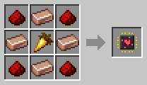 |
| Butcher | 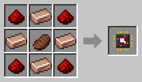 |
| Power Porter | 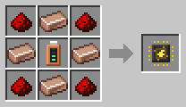 |
| Fluid Porter | 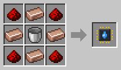 |
| Miner | 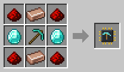 |
| Wool-E | 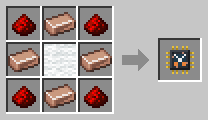 |
| ArcBot | 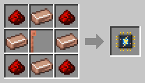 |
| Beekeeper | 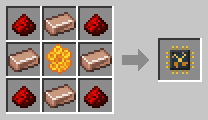 |
| Milker | 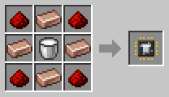 |
| Storage Manager | 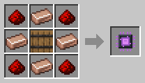 |
| Crafter | 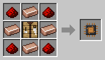 |
