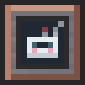
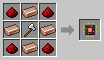
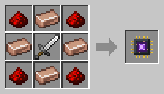
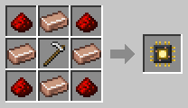
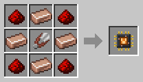
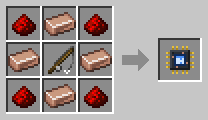

# Robot Workshop

[Home](README.md)

 

The Robot Workshop builds robots and changes them. It needs energy: give it a [Battery or generator](Energy.md) right next to it, or a pipe.

## Building a robot
1. Put a **Robot Frame** in the slot at the top.
2. Put a **Neural Chip** in the chip slot. The chip decides what kind of [robot](Robots.md) you get.
3. After **10 seconds** and **4 000 FE**, the frame is a robot.

## Modules
Under the robot slot there is a slot for each kind of module:

| Slot | Module |
|---|---|
| Chip | a Neural Chip: what the robot does |
| Filter | a [Filter Chip](Filter-Chips.md) |
| Battery | a [Battery Module](Battery-Modules.md) |
| Upgrade | an [Upgrade](Upgrades.md) |

- **To put a module in,** put it in its slot. The module the robot had before comes out in the output slot.
- **To take a module out,** click it. Modules the robot already has are shown faded in their slots. A module turns red until it is out; click it again to keep it.
- Putting a module in or taking one out takes **5 seconds** and **2 000 FE**.
- **The chip comes out last.** A robot whose chip is taken out becomes a Robot Frame again, so take the other modules out first.

The robot stays in its slot the whole time. Use the **Sides** button to let hoppers and pipes put frames and modules in.

## Neural Chips
| Chip | Recipe |
|---|---|
| Transporter |  |
| Collector |  |
| Lumberjack |  |
| Killer |  |
| Planter |  |
| Harvester |  |
| Fisher |  |
| Breeder |  |
| Butcher |  |
| Power Porter |  |
| Fluid Porter |  |
| Miner |  |
