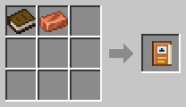

# Robotics Manual

[Home](README.md)

An in-game guide book about everything in the mod. **Every player gets one the first time they join a world** with the mod.

Right-click to read it. It opens as a book of two pages, with a tab on the side for each group of chapters: Start here, Robots, Storage and Crafting, Modules, and Tools and blocks. Click a chapter in a group's list to go to it, and turn pages with the arrows.

- **Getting Started** shows the recipes in the order you need them, from the Robotics Foundry to the Robot Linker.
- **A chapter about a robot** opens with the robot turning in 3D and the recipe for its chip. Chapters about blocks and modules show their crafting recipes. Where there are more than fit, arrows go through them, and they move on by themselves.
- **Setting something up** is shown as steps, each with the item it is about beside it. The Robot Panel, the Robot Workshop and the Order Terminal are shown as small pictures.
- **Links** in the text and under *See also* take you to other chapters, and **Back** takes you back.
- **Feedback** opens a short form in your browser, to tell about a bug, a change you want, or an idea for a new robot. No account needed.

The manual is in English and Norwegian.

Lost it? Craft a new one from a book and a copper ingot.

