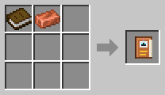

# Robotics Manual

[Home](README.md)

An in-game guide book about everything in the mod. **Every player gets one the first time they join a world** with the mod.

Right-click to read it. It opens on a list of chapters; click one to go to it, and turn pages with the arrows. Each chapter starts with the items it is about: hover over one to see its name. The manual is in English and Norwegian.

Lost it? Craft a new one from a book and a copper ingot.

