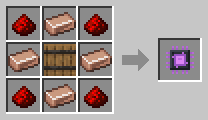

# Storage Manager

[Home](README.md) · [Robots](Robots.md)

The Storage Manager works for an [Order Terminal](Order-Terminal.md). It fetches what you order there from the terminal's chests and brings it to the output, and carries what you put in the input out to the chests. It brings the ingredients to the [Crafters](Crafter.md), too.

## Recipe
Build it at the [Robot Workshop](Robot-Workshop.md) from a Robot Frame and a **Storage Manager Neural Chip**.

## Setup
With the [Robot Linker](Robot-Linker.md), click:
1. the Order Terminal it works for;
2. its charging station.

You don't link it to the chests: they are set up once, in the terminal's [Setup panel](Order-Terminal.md#the-setup-panel), and every Storage Manager working for that terminal uses them. In its Robot Panel, **Change** links it to another terminal.

## Tips
- More Storage Managers fetch faster: they share the orders between them.
- A [Capacity Upgrade](Upgrades.md) lets it carry two stacks, one in each hand: two orders from two chests in one trip, or two kinds from the input, each put away with its own kind.
- Put away from the input, things go to a chest that already has the same kind if there is room.
- When it has nothing to do, it waits where its last job took it.
- Uses the normal amount of energy (1×).
