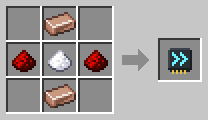
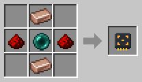
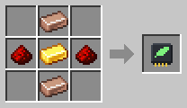
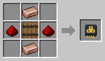
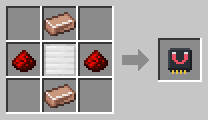
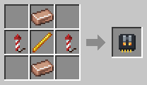
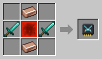

# Upgrades

[Home](README.md)

A robot can have **one upgrade**, put in at the [Robot Workshop](Robot-Workshop.md) in the upgrade slot.

| Upgrade | What it does | Recipe |
|---|---|---|
|  **Speed** | Walks 30 % faster. A [Fisher](Fisher.md) also gets bites sooner. |  |
|  **Range** | Work areas up to 48 × 48 instead of 32 × 32. |  |
|  **Efficiency** | Uses 25 % less energy, also while standing still. |  |
|  **Capacity** | Carries more: a Transporter or Collector two stacks, a Harvester, Fisher, Butcher or Wool-E eight, a Power Porter 50 000 FE, a Fluid Porter 8 buckets. |  |
|  **Magnet** | A [Collector](Collector.md) picks items up from 3 blocks away, even over a fence or wall. |  |
|  **Jetpack** | A [Miner](Miner.md) flies up and down its shaft, much faster than climbing, and needs no ladders. |  |
|  **Combat** | A [Killerbot](Killerbot.md) gets diamond swords that reach 4 blocks instead of 2 and hit twice as hard. An [ArcBot](ArcBot.md)'s arcs reach 14 blocks instead of 10 and hit harder. |  |
