# Upgrades

[Home](README.md)

A robot can have **one upgrade**, put in at the [Robot Workshop](Robot-Workshop.md) in the upgrade slot.

| Upgrade | What it does | Recipe |
|---|---|---|
|  **Speed** | Walks 30 % faster. A [Fisher](Fisher.md) also gets bites sooner. | 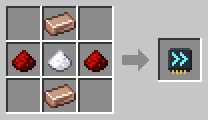 |
|  **Range** | Work areas up to 48 × 48 instead of 32 × 32. | 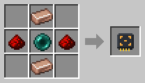 |
|  **Efficiency** | Uses 25 % less energy, also while standing still. | 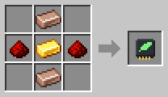 |
|  **Capacity** | Carries more: a Transporter or Collector two stacks, a Harvester, Fisher, Butcher or Wool-E eight, a Power Porter 50 000 FE, a Fluid Porter 8 buckets. | 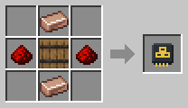 |
|  **Magnet** | A [Collector](Collector.md) picks items up from 3 blocks away, even over a fence or wall. | 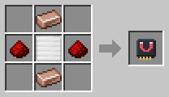 |
|  **Jetpack** | A [Miner](Miner.md) flies up and down its shaft, much faster than climbing. | 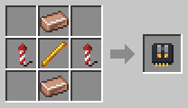 |
|  **Luck** | A [Miner](Miner.md) gets more from ores, as with **Fortune III**. A [Fisher](Fisher.md) catches more treasure and less junk, as with **Luck of the Sea III**: about 11 treasures and 4 junk in 100 catches instead of 5 and 10. | 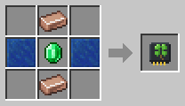 |
|  **XP** | A [Collector](Collector.md) also picks up **experience orbs** in its area and takes them as Liquid Experience to a tank you set in its Robot Panel. Shift + right-click a [Glass Tank](Glass-Tank.md) of it with an empty hand to take the experience. | 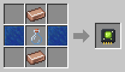 |
|  **Axe** | A [Lumberjack](Lumberjack.md) fells trees **twice as fast**. A tree takes 3 seconds and half a second for each log, so a big one takes a while without it. | 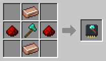 |
|  **Forestry** | A [Lumberjack](Lumberjack.md) also plants the saplings it has to spare in rows, three blocks apart, whenever it has nothing to fell, so the forest **spreads over its whole area**. Throw a few saplings in its area and it plants them too. Without it, a Lumberjack only plants where a tree stood. | 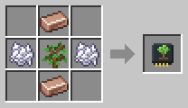 |
|  **Watering Can** | A [Planter](Planter.md) waters a crop in its area every few seconds while it has nothing to till or sow, giving it a little extra growth. The effect is spread over the whole field: a small field grows about a third faster, a big one hardly faster at all. | 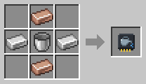 |
|  **Combat** | A [Killerbot](Killerbot.md) gets diamond swords that reach 4 blocks instead of 2 and hit twice as hard. An [ArcBot](ArcBot.md)'s arcs reach 14 blocks instead of 10 and hit harder. Both get a [Force Shield](Force-Shield.md) of 40 instead of 30. | 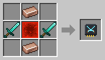 |
