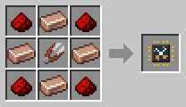

# Wool-E

[Home](README.md) · [Robots](Robots.md)

Wool-E shears the sheep in its area with its shears, and brings the wool to its delivery chest. It's the woolly cream robot with blue overalls.

## How it works
- It walks up to the nearest sheep that has wool, snips for a moment, and the wool goes straight into its basket.
- **Lambs** and **sheep without wool** are left alone. Once the wool has grown back, it shears them again.
- It brings the wool to its chest when its basket is full (4 stacks), now and then, or when there is no sheep left to shear.

## Recipe
Build it at the [Robot Workshop](Robot-Workshop.md) from a Robot Frame and a **Wool-E Neural Chip**.

## Setup
With the [Robot Linker](Robot-Linker.md), click:
1. two corners on the ground for its area;
2. the chest to deliver to (Shift + click more than one, see [more than one chest](Robot-Linker.md#more-than-one-chest));
3. its charging station.

## Tips
- A [Filter](Filter-Chips.md) with wool picks the colors it shears: a Whitelist Filter with white wool shears only white sheep, and a Blacklist Filter with black wool leaves the black ones alone.
- A [Capacity Upgrade](Upgrades.md) doubles its basket to 8 stacks.
- With a [Breeder](Breeder.md) in the same pen, there are always more sheep.
